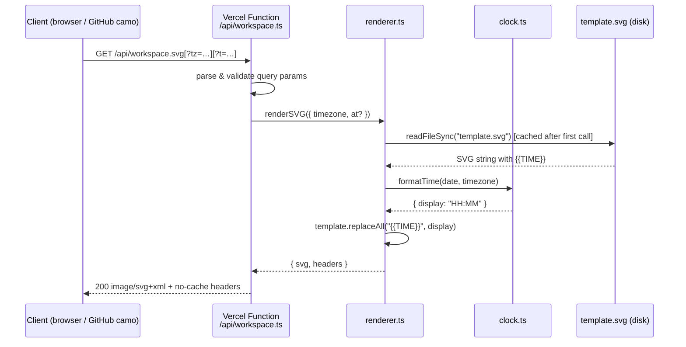

# Design Document: dynamic-workspace-svg

## Overview

A self-contained SVG that composites a pixel-art workspace GIF as a base64-embedded
raster background and overlays a server-injected live clock in the exact position of
the in-artwork clock display.  The serverless function replaces a `{{TIME}}`
placeholder at request time — no JavaScript runs inside the SVG, making it
compatible with GitHub README `` embeds.

---

## Main Algorithm / Workflow



---

## Core Interfaces / Types

```typescript
// src/clock.ts
interface FormattedTime {
  display:  string;   // "HH:MM"  e.g. "01:17"
  hours:    string;   // "HH"     e.g. "01"
  minutes:  string;   // "MM"     e.g. "17"
}

// src/renderer.ts
interface RenderOptions {
  timezone?: string;        // IANA timezone string
  at?:       Date | string; // fixed time override (for tests / preview)
}

interface RenderResult {
  svg:     string;                  // fully-rendered SVG text
  headers: Record<string, string>;  // HTTP headers to forward
}
```

---

## Key Functions with Formal Specifications

### `padTwo(n: number): string`

```typescript
function padTwo(n: number): string
```

**Preconditions:**
- `n` is a non-negative integer in range `[0, 59]`

**Postconditions:**
- Returns a string of exactly 2 characters
- If `n < 10`: result starts with `"0"`
- For all valid inputs: `parseInt(result, 10) === n`

---

### `formatTime(date?, timezone?): FormattedTime`

```typescript
function formatTime(date: Date = new Date(), timezone: string = DEFAULT_TIMEZONE): FormattedTime
```

**Preconditions:**
- `date` is a valid `Date` object (not `Invalid Date`)
- `timezone` is a valid IANA timezone string

**Postconditions:**
- `result.display` matches `/^\d{2}:\d{2}$/`
- `result.hours === result.display.slice(0, 2)`
- `result.minutes === result.display.slice(3, 5)`
- `parseInt(result.hours, 10)` is in `[0, 23]`
- `parseInt(result.minutes, 10)` is in `[0, 59]`
- No AM/PM suffix in any field
- Midnight is represented as `"00:00"`, not `"24:00"`

---

### `renderSVG(options?): RenderResult`

```typescript
function renderSVG(options: RenderOptions = {}): RenderResult
```

**Preconditions:**
- `template.svg` exists and is readable
- `template.svg` contains at least one `{{TIME}}` placeholder
- If `options.timezone` provided, it must be a valid IANA string
- If `options.at` provided as string, it must be parseable by `new Date()`

**Postconditions:**
- `result.svg` contains no `{{TIME}}` literals
- `result.svg` starts with `<?xml` or `<svg`
- `result.svg` contains a valid HH:MM string in the clock-digits text element
- `result.headers["Content-Type"]` contains `"image/svg+xml"`
- `result.headers["Cache-Control"]` contains `"no-cache"` and `"no-store"`

**Loop Invariants:** N/A (single string replacement, no iteration)

---

## Algorithmic Pseudocode

### Main request-handling algorithm

```pascal
ALGORITHM handleRequest(req)
INPUT:  req (HTTP GET request)
OUTPUT: HTTP response (SVG or error)

BEGIN
  IF req.method NOT IN {"GET", "HEAD"} THEN
    RETURN 405 Method Not Allowed
  END IF

  tz ← req.query["tz"]
  IF tz IS NULL OR NOT isValidTimezone(tz) THEN
    tz ← DEFAULT_TIMEZONE
  END IF

  t ← req.query["t"]
  overrideDate ← NULL
  IF t MATCHES /^([01]\d|2[0-3]):[0-5]\d$/ THEN
    overrideDate ← buildUTCDate(t.hours, t.minutes)
    tz ← "UTC"   -- literal display, skip conversion
  END IF

  TRY
    result ← renderSVG({ timezone: tz, at: overrideDate })
    FOR EACH header IN result.headers DO
      setResponseHeader(header.key, header.value)
    END FOR
    RETURN 200 result.svg
  CATCH error
    LOG error
    RETURN 500 "Internal Server Error"
  END TRY
END
```

### Time formatting algorithm

```pascal
ALGORITHM formatTime(date, timezone)
INPUT:  date      — a Date object
        timezone  — IANA timezone string
OUTPUT: FormattedTime { display, hours, minutes }

BEGIN
  formatter ← Intl.DateTimeFormat("en-US", {
    timeZone: timezone,
    hour:     "2-digit",
    minute:   "2-digit",
    hour12:   false
  })

  parts ← formatter.formatToParts(date)
  rawHour   ← parts["hour"]
  rawMinute ← parts["minute"]

  -- Normalise: some engines return "24" for midnight
  hourNum   ← parseInt(rawHour)   MOD 24
  minuteNum ← parseInt(rawMinute)

  hours   ← padTwo(hourNum)
  minutes ← padTwo(minuteNum)

  RETURN { display: hours + ":" + minutes, hours, minutes }
END
```

### SVG injection algorithm

```pascal
ALGORITHM renderSVG(options)
INPUT:  options { timezone?, at? }
OUTPUT: RenderResult { svg, headers }

BEGIN
  timezone ← options.timezone ?? DEFAULT_TIMEZONE
  date     ← options.at ?? new Date()

  IF _templateCache IS NULL THEN
    _templateCache ← readFileSync("template.svg", "utf-8")
  END IF

  formatted ← formatTime(date, timezone)

  svg ← _templateCache.replaceAll("{{TIME}}", formatted.display)

  ASSERT svg DOES NOT CONTAIN "{{TIME}}"
  ASSERT svg CONTAINS formatted.display

  headers ← {
    "Content-Type":    "image/svg+xml; charset=utf-8",
    "Cache-Control":   "no-cache, no-store, must-revalidate",
    "Pragma":          "no-cache",
    "Expires":         "0",
    "Surrogate-Control": "no-store"
  }

  RETURN { svg, headers }
END
```

---

## SVG Layer Architecture

```
template.svg
│
├── <defs>
│   ├── <filter id="clockGlow">        — red LED glow
│   │   ├── feFlood (flood-color: #FF2040)
│   │   ├── feComposite (in operator)
│   │   ├── feGaussianBlur (stdDeviation: 3.5)
│   │   └── feMerge (blur ×2 + SourceGraphic)
│   └── <filter id="bezelShadow">      — depth shadow on bezel
│       └── feDropShadow
│
├── <image id="background-art">        — base64 GIF, 1024×576
│
└── <g id="clock-layer">
    ├── <rect id="clock-bezel">        — dark rounded rect (#0a0005)
    │   x=488, y=122, w=134, h=46, rx=4
    ├── <text id="clock-ghost">        — "88:88" in dim red (#3a0010)
    └── <text id="clock-digits">       — {{TIME}} in bright red (#FF2040)
        filter="url(#clockGlow)"
```

---

## Clock Position Constants (from `src/config.ts`)

All coordinates reference the 1024 × 576 source image.

| Constant | Value | Notes |
|---|---|---|
| `CLOCK_BEZEL_X` | `488` | Left edge of bezel |
| `CLOCK_BEZEL_Y` | `122` | Top edge of bezel |
| `CLOCK_BEZEL_WIDTH` | `134` | Covers the artwork clock display |
| `CLOCK_BEZEL_HEIGHT` | `46` | |
| `CLOCK_BEZEL_RX` | `4` | Corner radius |
| `CLOCK_TEXT_X` | `555` | Horizontal centre (488 + 134/2) |
| `CLOCK_TEXT_Y` | `155` | Vertical baseline (122 + 46 × 0.72) |
| `CLOCK_FONT_SIZE` | `28` | px |
| `CLOCK_DIGIT_COLOR` | `"#FF2040"` | Red-pink matching reference |
| `CLOCK_DIGIT_DIM_COLOR` | `"#3a0010"` | Ghost segments |
| `GLOW_STD_DEVIATION` | `3.5` | Blur radius |

---

## Example Usage

```typescript
// Direct render with default timezone (Asia/Kolkata)
const { svg, headers } = renderSVG();

// Render for a different timezone
const { svg } = renderSVG({ timezone: "America/New_York" });

// Render at a fixed time (for testing or screenshots)
const { svg } = renderSVG({
  at: new Date("2024-01-01T19:47:00Z"),
  timezone: "Asia/Kolkata", // → displays "01:17"
});

// From the API handler
export default function handler(req: VercelRequest, res: VercelResponse) {
  const { svg, headers } = renderSVG({ timezone: "Asia/Kolkata" });
  for (const [k, v] of Object.entries(headers)) res.setHeader(k, v);
  res.status(200).send(svg);
}
```

---

## Correctness Properties

- **∀ valid dates d, timezones tz:** `formatTime(d, tz).display` matches `/^\d{2}:\d{2}$/`
- **∀ integers n ∈ [0, 59]:** `padTwo(n).length === 2`
- **∀ integers n ∈ [0, 9]:** `padTwo(n)[0] === '0'`
- **∀ render calls:** `renderSVG().svg` does not contain the string `"{{TIME}}"`
- **∀ render calls:** `renderSVG().headers["Cache-Control"]` contains `"no-store"`
- **Midnight invariant:** `formatTime(midnight, tz).hours !== "24"`
- **Idempotency:** `renderSVG({ at: d }).svg === renderSVG({ at: d }).svg` (same date → same output)

---

## Error Handling

| Scenario | Response | Recovery |
|---|---|---|
| `template.svg` missing | 500 Internal Server Error | Deploy includes the template; if missing, redeploy |
| Invalid `?tz=` param | Silently falls back to `DEFAULT_TIMEZONE` | Valid output always returned |
| Malformed `?t=` param | Param ignored, live time used | Valid output always returned |
| Wrong HTTP method | 405 Method Not Allowed | Client should use GET |
| Intl timezone error | Caught by `isValidTimezone`; falls back to default | No 500 from bad tz input |

---

## Testing Strategy

### Unit Testing (Vitest)

- `padTwo`: leading zeros, two-digit passthrough, midnight
- `formatTime`: format shape, leading zeros in both fields, 24-hour format, timezone math
- `isValidTimezone`: valid/invalid IANA strings
- `renderSVG`: placeholder replacement, SVG validity, filter/colour presence, HTTP headers
- Edge cases: midnight `00:00`, end-of-day `23:59`, ISO string input

### Property-Based Testing Approach

The following properties are suited to generative testing (e.g., fast-check):
- `padTwo(n)` always returns a 2-character string for `n ∈ [0, 59]`
- `formatTime` never returns a string not matching `/^\d{2}:\d{2}$/`
- `renderSVG` output never contains `{{TIME}}`

**Property Test Library:** vitest + fast-check (can be added; current suite uses example-based tests sufficient for the scope)

---

## Performance Considerations

- Template is cached in-process after the first disk read — subsequent requests in the same serverless invocation are pure string operations (~1 ms).
- The base64-embedded GIF adds ~1.3 MB to each response.  For bandwidth-sensitive deployments, convert the source GIF to WebP/AVIF first and re-encode.
- Vercel functions are stateless; the cache is per-invocation, not global.  Cold starts incur one disk read.

---

## Security Considerations

- All query parameters are validated before use; invalid values are silently replaced with safe defaults.
- The SVG contains no `<script>` elements; XSS via SVG injection is not possible.
- The `?t=` parameter is regex-validated against `/^([01]\d|2[0-3]):[0-5]\d$/` before use.
- No user input is reflected into the SVG beyond the validated time string.

---

## Dependencies

| Package | Version | Purpose |
|---|---|---|
| `@vercel/node` | `^3.0.0` | TypeScript types for Vercel serverless handlers |
| `typescript` | `^5.3.0` | Compile-time type safety |
| `vitest` | `^1.0.0` | Test runner |
| `@vitest/coverage-v8` | `^1.0.0` | Coverage reports |
| `vercel` | `^33.0.0` | Local dev server (`vercel dev`) |

No runtime dependencies beyond Node.js built-ins (`fs`, `path`, `url`, `Intl`).
